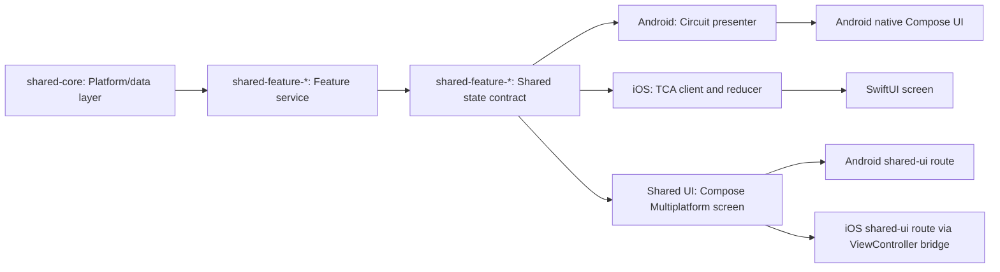
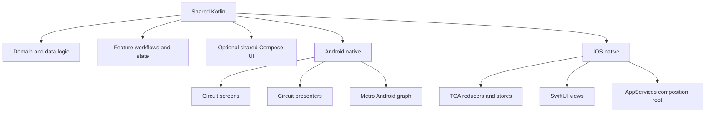
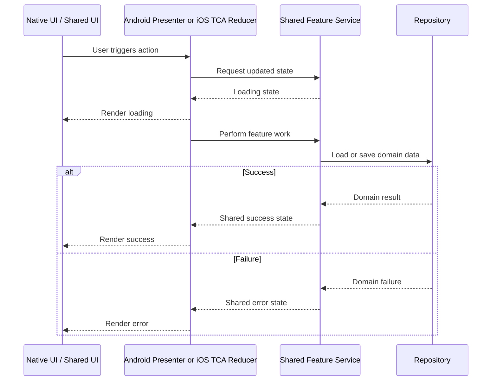

# How To Add A Feature

This repo follows a native-first shell with shared business logic pattern.
When adding a new feature, the goal is not to decide everything from scratch.
The goal is to repeat the same ownership boundaries that already work for the
`home` feature.

Use this document as the default blueprint unless the feature introduces a
materially new architectural concern.

## The rule

- Shared Kotlin owns domain, data, business rules, and feature state
  transitions.
- Android owns Android presentation through Circuit.
- iOS owns iOS presentation through TCA and SwiftUI.
- Shared Compose UI is optional and only added when it clearly reduces
  duplication.

If a new file makes you ask "is this behavior or presentation?", that usually
answers where it should live.

## Mental model

Use these diagrams as the fast architectural reference before following the
feature checklist.

### Feature flow

The important part is the middle seam: shared Kotlin owns the feature
workflow and typed state contract, then Android, iOS, and optional shared
Compose each adapt that contract in their own rendering layer.

### Ownership split

This is the intended split of responsibilities: shared Kotlin owns reusable
behavior, while each platform owns its native shell and its platform-specific
composition root.

### Sequence

This sequence is what we want to preserve as features grow: the native shell
reacts to user intent, shared Kotlin performs the business work, and the UI
renders typed state transitions instead of reproducing domain rules locally.

## Ownership map

Use this table when deciding where a new file should land.

| Concern | Own it here | Current reference |
| --- | --- | --- |
| Domain models, repository contracts, data access, API and persistence adapters | `shared-core/` | `CounterRepository.kt`, `NearbyFleetRepository.kt` |
| Shared feature rules, typed async state, feature orchestration | `shared-feature-*/` | `HomeFeatureState.kt`, `CounterLoadable.kt`, `HomeFeatureService.kt` |
| Shared Kotlin dependency graph and construction helpers | `shared-di/` | `SharedDependencies.kt` |
| Optional reusable shared Compose screen | `shared-ui-*/` | `HomeContent.kt` |
| Android presenter orchestration and Circuit contracts | `android-app/` | `HomePresenter.kt`, `HomeScreen.kt` |
| Android native Compose rendering and app navigation | `android-app/` | `HomeUi.kt`, `AppShell.kt` |
| Android platform composition root | `android-app/` | `AndroidAppGraph.kt` |
| iOS reducer, actions, effects, and state mapping | `ios-app/` | `HomeFeature.swift`, `HomeFeature+State.swift`, `HomeCounterLoadable.swift` |
| iOS native SwiftUI rendering and navigation | `ios-app/` | `HomeView.swift`, `RootView.swift` |
| iOS platform composition root and dependency injection bridge | `ios-app/` | `AppServices.swift`, `HomeFeatureClient.swift` |

## Suggested module shape

For a feature named `profile`, the default module shape should be:

- `shared-core/`
  Repository contracts, fake or real data sources, DTO mapping, persistence,
  and domain logic reused by multiple features.
- `shared-feature-profile/`
  Shared feature contract, typed state, events, service or use-case
  orchestration, and tests.
- `shared-ui-profile/`
  Optional shared Compose screen for the feature.
- `android-app/`
  Circuit screen, presenter, UI, Android graph wiring, and Android-specific
  tests.
- `ios-app/`
  TCA reducer, Swift-native state mapping, client adapter, SwiftUI views, and
  iOS-specific tests.

Not every feature needs `shared-ui-*`. Add it only when we actually want a
shared Compose path.

## Design checkpoint

Before implementation starts, sketch the feature's shared state and policy
shape. The goal is not to overdesign; it is to catch ambiguity while it is
cheap.

A good design-phase sketch should answer:

- What are the mutually exclusive states, and which variants carry values?
- Which states represent real absence, and which should be separate sealed
  cases instead of nullable payloads?
- Which decisions are business policy, such as freshness, retry eligibility,
  failure interpretation, or request eligibility?
- Which values should be shared domain models, and which should be native
  presentation models?
- Which Android and iOS adapters will map shared state into platform-specific
  screen state?
- Which tests prove the important transitions before native UI is wired?

Prefer sealed state with value-bearing variants over nullable bags of data.
For example, model `FailedWithSnapshot(snapshot)` and
`FailedWithoutSnapshot` when those states behave differently, instead of one
`Failed(previousSnapshot?)` variant.

When multiple concrete states share behavior, use named contracts carefully.
They can make Kotlin call sites cleaner, but they should not obscure concrete
sealed cases needed by Swift adapters.

## Step-by-step

### 1. Start in shared core

Add shared data and domain seams in [`shared-core/`](../../shared-core).

Typical additions:

- repository interface
- fake implementation
- API client adapter
- persistence adapter
- domain model transformation

Good examples:

- [`CounterRepository.kt`](../../shared-core/src/CounterRepository.kt)
- [`NearbyFleetRepository.kt`](../../shared-core/src/NearbyFleetRepository.kt)

This layer should not know anything about Circuit, TCA, Compose screens, or
SwiftUI views.

### 2. Create the shared feature module

Add a new `shared-feature-*` module for the feature contract and behavior.

The default contents should be:

- feature state
- typed async state if needed
- events or actions if needed
- feature service or use-case facade
- tests for state transitions

The `home` feature is the reference shape:

- [`HomeFeatureState.kt`](../../shared-feature-home/src/HomeFeatureState.kt)
- [`CounterLoadable.kt`](../../shared-feature-home/src/CounterLoadable.kt)
- [`HomeFeatureService.kt`](../../shared-feature-home/src/HomeFeatureService.kt)

Use type-driven state for mutually exclusive async states. Prefer sealed types
over booleans like `isLoading` when the feature has distinct states such as
initial, loading, loaded, and error.

Avoid nullable feature-state payloads unless absence itself is the domain
concept. If callers repeatedly need `thingOrNull()` helpers, consider whether
the shared state should expose a more precise sealed case or a small named
contract for the value-bearing variants.

Keep orchestration services focused on transitions. Extract nameable policy
objects for reusable rules such as staleness windows, refresh cadence,
eligibility, retries, and failure-to-overlay interpretation.

### 3. Wire shared DI

Register the feature's shared dependencies in
[`shared-di/`](../../shared-di).

That usually means:

- repository binding
- fake or real implementation choice
- feature service exposure
- test-friendly construction helpers

Reference:

- [`SharedDependencies.kt`](../../shared-di/src/SharedDependencies.kt)

The shared Metro graph is the Kotlin-side composition root. Tests should also
be able to construct the same feature wiring without ad hoc object assembly.

### 4. Add Android presentation

Implement the Android shell in [`android-app/`](../../android-app).

Follow the existing split:

- `FeatureScreen.kt`
- `FeaturePresenter.kt`
- `FeatureUi.kt`

And wire it into the Android graph:

- [`AndroidAppGraph.kt`](../../android-app/src/AndroidAppGraph.kt)

Android owns:

- Circuit screen contracts
- presenter orchestration
- navigation
- Android-only UI composition

Shared Kotlin should feed Android state, but should not expose Circuit types.

Choose state lifetime separately from work lifetime. Native Home and Nearby use
keyed Circuit retention providers in `AppDestinationContent`; visible loading and
coroutine scopes remain composition-owned. The content owner remembers Circuit,
keeping its service/factory identities stable across tab recomposition. Retained
values must not capture jobs, callbacks or UI objects.

Home retains its exact last ready state. Its requests use one child scope per
STARTED host lifetime, with synchronous stop/disposal cleanup through the existing
LifecycleStartEffect API. The ephemeral callback-to-scope handle is not retained
feature state. A request's recovery guard must inspect its captured owner, not a
newer scope created after restart. See [ADR 0013](../adr/0013-android-home-visible-work-lifetime.md)
for the explicit ownership cost and qualification limits. Nearby stores its existing shared
cancellation-normalized value and revalidates location on return. A cached snapshot
can be shown while Resolving, with actions disabled; known blocked decisions stay
blocked. Apply shared time/failure policy to a retained visible-location failure
before using it again. Qualify both late results and old callbacks before allowing
them to write retained state. See [ADR 0010](../adr/0010-android-home-tab-state-lifetime.md)
and [ADR 0011](../adr/0011-android-nearby-tab-state-lifetime.md) for the explicit
costs and remaining recreation/process-restoration scope. Nearby's timer uses
LifecycleStartEffect with a separate timer scope so request supersession cannot
cancel future ticks. Stop cancels the timer; each START waits a full interval.
Requests already launched and location/manual callbacks remain composition-owned;
request cancellation and location revalidation on host START are separate work.

### 5. Add iOS presentation

Implement the iOS shell in [`ios-app/`](../../ios-app).

Follow the current TCA pattern:

- reducer
- actions
- state mapping
- shared client adapter
- SwiftUI screen and subviews

Reference files:

- [`HomeFeature.swift`](../../ios-app/src/Features/Home/HomeFeature.swift)
- [`HomeFeatureClient.swift`](../../ios-app/src/Features/Home/HomeFeatureClient.swift)
- [`HomeFeature+State.swift`](../../ios-app/src/Features/Home/HomeFeature+State.swift)

iOS owns:

- TCA reducer and effects
- Swift-native presentation state when needed
- navigation and platform-specific UI concerns
- SwiftUI views and composition

Shared Kotlin should feed feature behavior, but should not expose TCA types.

Keep feature stores in a stable owning scope. `AppRootView` retains Native Home
and Nearby stores with `@StateObject` for the scene's lifetime instead of creating
them in `body`. Repeated view tasks preserve existing state: Home initializes only
while its counter remains initial. Nearby initializes only while its shared state is
absent, then begins location revalidation on each task. Its single native content
value distinguishes preparing, checking with retained shared data, and ready.
A cached map stays visible during checking, but manual/timer refresh and interactions
wait for a current location result. Keeping the previous shared value inside the
checking case preserves temporary-loss fallback even without a snapshot. A new
check normalizes loading through shared cancellation policy and cancels the prior
refresh effect. Before checking a previously visible location, apply the shared
failure-aging policy using the reducer's injected date. The checking value keeps
that aged state through temporary-location fallback. Known blocked decisions
bypass aging and remain blocked. See
[ADR 0012](../adr/0012-ios-nearby-location-revalidation.md); platform location delivery
and scene/process lifetime remain separate qualification work.

For native iOS, export sealed states through the generated feature modules and
switch directly on `value.sealedType()`. Kotlin enum reasons are generated Swift
enums. Handle every case and read typed payloads; do not add string tags, native
default branches or handwritten visitor protocols. Add the feature to the explicit
public export graph and keep implementation dependencies private. See
[ADR 0009](../adr/0009-generated-swift-export-for-native-features.md) for the current
producer and its retirement checks.

Home's [`HomeFeatureClient`](../../ios-app/src/Features/Home/HomeFeatureClient.swift)
copies shared state into the existing native `Sendable` counter value before
returning it to the reducer. Its generated-case mapping is private to that client;
Home's reducer, actions and presentation state use native values. Refresh receives
the native value captured before entering loading, so a client-level
`CancellationError` restores that exact value and preserves retry. Kotlin domain
failures remain typed failures. TCA still suppresses sends from cancelled effects;
a future UI cancel operation needs its own reducer transition.

Keep business transitions in Kotlin. Nearby distinguishes client cancellation
from other thrown errors: cancellation restores a retryable shared state; other
errors use the service's existing `Unexpected` failure policy, retaining the
snapshot and applying its stale-window overlay. Repository failures keep their
typed reason. No separate native interop-error state is introduced.

Nearby retains its shared state; its unchecked crossing and preconcurrency imports
remain tracked as IOS-02 rather than being presented as checked isolation.

### 6. Decide whether shared Compose UI is worth it

Only add `shared-ui-*` when the feature benefits from a reusable shared screen.

Good reasons to add it:

- the screen is visually similar on both platforms
- it is useful as a shared demo or reference route
- we want to prove the shared feature contract can drive Compose
  Multiplatform UI too

Reference:

- [`HomeContent.kt`](../../shared-ui-home/src/HomeContent.kt)

If the feature is deeply platform-native, skip this module.

### 7. Add tests in three layers

Every feature should ideally have tests in these layers:

- shared Kotlin tests for repository and feature behavior
- Android presentation tests for presenter transitions
- iOS TCA reducer tests with `TestStore`

Reference tests:

- [`FakeCounterRepositoryTest.kt`](../../shared-core/test/FakeCounterRepositoryTest.kt)
- [`HomeFeatureServiceTest.kt`](../../shared-feature-home/test/HomeFeatureServiceTest.kt)
- [`HomePresenterStateProducerTest.kt`](../../android-app/test/home/HomePresenterStateProducerTest.kt)
- [`HomePresenterTest.kt`](../../android-app/test/home/HomePresenterTest.kt) for queued admission and retained callbacks
- [`HomeTabLifetimeTest.kt`](../../android-app/test/home/HomeTabLifetimeTest.kt) for production Home tab-content retention and cancelled work
- [`NearbyTabLifetimeTest.kt`](../../android-app/test/nearbyvehiclemap/NearbyTabLifetimeTest.kt) for Nearby retention, revalidation and timer ownership
- [`NearbyVehicleMapPresenterTest.kt`](../../android-app/test/nearbyvehiclemap/NearbyVehicleMapPresenterTest.kt) for actual Compose effects
- [`HomeFeatureTests.swift`](../../ios-app/tests/Features/Home/HomeFeatureTests.swift)

Current repo conventions:

- Kotlin tests use BDD-style names like `should have state X when Y`
- Kotlin tests should use explicit `given`, `when`, and `then` sections
- Swift tests use Swift Testing with `@Test`
- Keep TCA feature suites nested under
  [`NativeFeatureTests`](../../ios-app/tests/NativeFeatureTests.swift) while
  IOS-13 applies; use extensions to keep feature test files separate. This protects
  TCA's shared executor setting. Concurrency scenarios still overlap requests
  within each test. Recheck parallel suites through the
  [retirement registry](../../maintenance-interop-workarounds.json).
- Tests needing object setup should use fixtures or factories instead of
  inlining noisy construction

For native correctness and presentation fixes, assess the other consumers and
record their status in the [cross-platform follow-ups](../maintenance/mobile-feature-follow-ups.md).
Shared service tests qualify shared behavior; actual presenter/reducer checks are
needed for native request ordering, cancellation and lifecycle ownership.

For Compose-owned work, use Circuit's version-matched `circuit-test` helpers to
exercise the actual presenter, with coroutine virtual time and a controlled
repository. The Android host runner uses Robolectric 4.16 at API 36, following the
[pinned Toolchain's supported example](https://github.com/JetBrains/kotlin-toolchain/tree/v0.13.0/sources/test-integration/test-projects/android/robolectric).
These are test-only dependencies; Circuit's helpers bring Molecule and Turbine,
and Robolectric resolves an instrumented Android runtime on first execution.
The app's `jvm.test.freeJvmArgs` enables native access for that runtime. This is
host lifecycle evidence, not device rendering, navigation or permission testing.
Keep effects keyed to their owner when their work changes observed state, and
check both completion across recomposition and cancellation on disposal.

For callback admission, also queue the presenter composition with
`moleculeFlow(...).flowOn(StandardTestDispatcher(testScheduler))` and observe it
through Turbine, using the already selected Circuit test dependencies. Send rapid
events before `runCurrent()`. Eager collection alone can hide a gap between a
callback check and a queued launch. On the presenter's single dispatcher, check
current eligibility and enter loading before suspending for repository work.
When an event means "refresh current", resolve inputs from current owned state at
that boundary; keep derived counter values out of retained UI callbacks.
The [admission tests](../../android-app/test/nearbyvehiclemap/NearbyVehicleMapPresenterTest.kt)
include a location decision changing before queued work starts.

Recheck [AND-01](../maintenance/mobile-feature-follow-ups.md#and-01-presenter-host-test-harness-simplification)
on relevant dependency updates to remove this harness cost when supported.

### 8. Document only the delta

If the feature follows the established pattern, lightweight docs are enough.

If the feature changes the architecture, update:

- [`mobile-architecture.md`](./mobile-architecture.md)
- add a new ADR in [`docs/adr/`](../adr)

Do not create architecture churn in docs for a normal feature that simply
follows the blueprint.

## Golden path

This is the recommended order of work:

1. sketch shared state, value-bearing variants, nullable boundaries, and policy
   seams
2. add repository or data seam in shared core
3. add feature service and typed state in shared feature
4. add shared tests for success, loading, and error
5. add Android Circuit shell
6. add iOS TCA shell
7. add optional shared Compose screen if it earns its place
8. update docs only if the architecture changed

## Smell checks

Before calling a feature "done", ask these questions:

- Can Android and iOS share the same business behavior without duplicating the
  rules?
- Are async states modeled as types instead of booleans?
- Are nullable payloads limited to real domain absence rather than being used
  as shortcuts for missing state variants?
- Are repeated `thingOrNull()` helpers avoided or intentionally contained at a
  platform adapter boundary?
- Are business policy rules extracted from orchestration once they become
  independently nameable?
- Does shared Kotlin avoid exposing Circuit or TCA types?
- Does Android own Android presentation concerns?
- Does iOS own iOS presentation concerns?
- If shared Compose exists, is it optional rather than mandatory for the app
  shell?
- Are tests present at shared and native presentation seams?

If the answer to most of these is "yes", the feature is probably landing in
the right places.

## When to break the pattern

It is reasonable to diverge from this blueprint when:

- the feature is purely platform-specific
- the UX differs substantially by platform
- the feature needs native-only integrations or system UI
- the feature is too small to justify a full shared feature module

Even then, prefer breaking the pattern consciously and documenting why, rather
than drifting accidentally.
